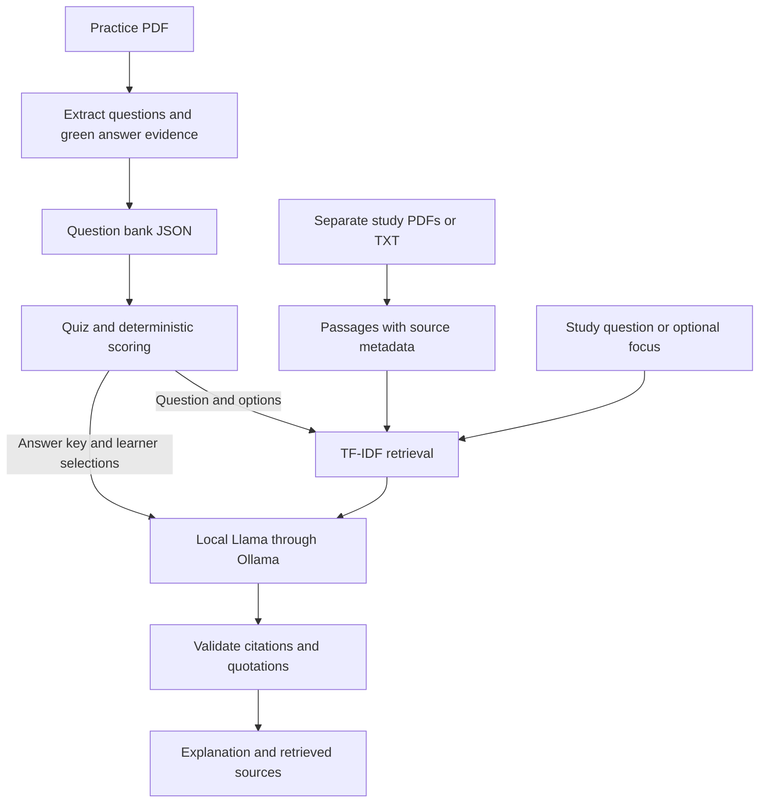

# MCQ Practice Assistant with Local RAG

A Python and Streamlit application that converts supported practice PDFs into interactive quizzes and generates study explanations from separately uploaded documents using Retrieval-Augmented Generation (RAG).

Built by **Sujith Nair** as a personal project to connect exam practice with evidence from study materials. The application combines document processing, data validation, information retrieval and local LLM inference.

## Features

- Extract numbered questions and options from supported text-based PDFs.
- Identify correct options using green-highlight evidence and export unresolved questions for review.
- Practice with single-answer radio buttons, multi-select checkboxes, review flags and navigation.
- Submit answers to view marks, percentages and answer review.
- Prepare separate PDF and UTF-8 TXT study materials with source metadata.
- Retrieve relevant passages using TF-IDF and generate explanations with Llama 3.2 through Ollama.
- Validate structured responses, citation identifiers and supporting quotations.
- Ask questions through the quiz review panel or the standalone study page.

## Architecture



The quiz uses the source answer key for grading. RAG uses the uploaded study corpus to explain concepts and help the learner review answers.

## Technology stack

| Technology | Role |
| --- | --- |
| Python | Extraction, processing, validation and application logic |
| Streamlit | Quiz interface, uploads, session state and results |
| PyMuPDF | PDF text and visual evidence extraction |
| scikit-learn | TF-IDF vectorization and passage retrieval |
| Ollama | Local model serving through its chat API |
| Llama 3.2 3B | Explanation generation |
| JSON | Question banks, prepared study materials and model responses |
| Git and GitHub | Source control and project documentation |

## Project files

| File | Purpose |
| --- | --- |
| `app.py` | Import a practice PDF and export a question bank |
| `extract_pdf.py` | Extract page text and green answer evidence |
| `parse_questions.py` | Parse question blocks, options and answer labels |
| `quiz.py` | Run the quiz, calculate scores and display study explanations |
| `study_materials.py` | Prepare PDF and TXT study passages |
| `rag_study.py` | Retrieve passages, call Ollama and validate responses |
| `requirements.txt` | Python dependency requirements |
| `examples/demo_question_bank.json` | Original fictional quiz fixture in the packaged demo |
| `examples/demo_study.txt` | Original fictional study material in the packaged demo |

## Setup

### 1. Open the project

Clone the repository and enter its directory. Access is required while the repository is private.

```bash
git clone https://github.com/zorick6800/mcq-rag-study-assistant.git
cd mcq-rag-study-assistant
```

The initial repository contains both root modules and a nested packaged copy. For the complete packaged demo, enter the directory below from the repository root. It contains the application modules, requirements and `examples` folder.

```bash
cd mcq-rag-study-assistant/mcq-rag-study-assistant
```

If the repository has been consolidated, run the remaining commands from the directory containing `quiz.py`, `rag_study.py`, `requirements.txt` and `examples`.

### 2. Install Python dependencies

Use Python 3.10 or newer. In Windows PowerShell or the PyCharm terminal, run each command separately.

```powershell
python -m venv .venv
.\.venv\Scripts\python.exe -m pip install -r requirements.txt
```

The packaged requirements include `streamlit`, `PyMuPDF` and `scikit-learn`. The initial root requirements omitted scikit-learn. If using that copy, install the missing retrieval dependency in the same environment.

```powershell
.\.venv\Scripts\python.exe -m pip install "scikit-learn>=1.4,<2"
```

On macOS or Linux, use the equivalent environment commands.

```bash
python3 -m venv .venv
.venv/bin/python -m pip install -r requirements.txt
```

### 3. Set up the local model

Install [Ollama](https://ollama.com/download), open a new terminal and download the model.

```bash
ollama pull llama3.2:3b
```

Keep the Ollama service running at `http://127.0.0.1:11434`. If the service is stopped, start it in a separate terminal.

```bash
ollama serve
```

If Ollama already uses that port, use the existing service. The quiz can run independently, while generated study explanations require the model service.

### 4. Start the application pages

Run each required page in a separate terminal from the same project directory.

```powershell
# Practice PDF import
.\.venv\Scripts\python.exe -m streamlit run app.py --server.port 8501

# Quiz and post-submission explanations
.\.venv\Scripts\python.exe -m streamlit run quiz.py --server.port 8502

# Study material preparation
.\.venv\Scripts\python.exe -m streamlit run study_materials.py --server.port 8503

# Standalone study assistant
.\.venv\Scripts\python.exe -m streamlit run rag_study.py --server.port 8504
```

On macOS or Linux, replace `.\.venv\Scripts\python.exe` with `.venv/bin/python`. Open the localhost URL displayed by Streamlit. Stop a page with `Ctrl+C` in its terminal.

## Usage

### Create and take a quiz

1. Open the PDF import page on port 8501.
2. Upload a supported practice PDF with green-highlighted correct options.
3. Review included and unresolved counts, then download `question_bank.json`.
4. Open the quiz on port 8502 and upload the question bank.
5. Select answers, save selections when prompted and flag questions for review.
6. Submit the quiz to view your score and answer review.

### Generate study explanations

1. Open the study-material preparation page on port 8503.
2. Upload your study PDF or TXT files and inspect the extracted content.
3. Download `study_materials.json`.
4. In the submitted quiz, open **Explain using my study materials**.
5. Upload the prepared study JSON and select a quiz question.
6. Optionally enter a focus and request an explanation.
7. Inspect the retrieved sources alongside the generated response.

Example focus prompts include “Explain why the source answer fits this scenario,” “Compare my selection with the correct answer,” and “Which requirements in the question help identify the answer?”

For independent questions, open the standalone study page on port 8504 and upload the same prepared study JSON.

## Try the packaged demo

The packaged `examples` folder contains a fictional Atlas quiz and study document.

1. Upload `examples/demo_question_bank.json` to the quiz.
2. For the first question, select **Archive Store**.
3. For the second question, select only **Event Monitor**, then submit.
4. The expected score is **1.5 out of 2, or 75%**.
5. Prepare `examples/demo_study.txt` on the study-material page.
6. Upload the resulting study JSON in the quiz review panel and request an explanation of question 2.

## How RAG works

1. **Document preparation.** Uploaded study files are deduplicated by content hash. Pages are split into passages of up to 300 words with 50 words of overlap within each page. Metadata retains the filename, page number where applicable and chunk identifier.
2. **Indexing.** A local scikit-learn TF-IDF index represents unigrams and bigrams from the passages.
3. **Retrieval.** The selected question, options and optional learner focus form the search query. Retrieval returns up to three passages with similarity scores of at least 0.04. This cutoff is a heuristic.
4. **Generation.** Retrieved passages are assigned source identifiers and sent to the local model. For quiz explanations, the prompt includes the source answer key and learner selections.
5. **Validation.** The application checks the response structure, source identifiers and quoted text against the retrieved passages after whitespace normalization. Invalid points are filtered. If no points validate, a validation failure can trigger one retry.
6. **Fallback.** When generation cannot produce accepted points, the user can inspect the retrieved passages. When retrieval finds no match, generation is skipped.

Quotation validation establishes that the quoted words appear in the cited passage. Whether the evidence supports the generated claim still requires review.

## Scoring rules

Each question is worth a maximum of one mark.

```text
Question score = selected correct options / total correct options
Percentage = total marks / included question count × 100
```

| Response | Score |
| --- | --- |
| Correct single answer | 1 |
| Incorrect or unanswered single answer | 0 |
| One of two correct options selected | 0.5 |
| Both correct options selected | 1 |

Incorrect selections carry no deduction. Selecting every option in a multi-select question therefore earns full credit under the current practice rule. Excluded unresolved questions are outside the score denominator.

## Engineering lessons

- **PDF boundaries matter.** Wrapped options and page headers can interrupt extracted text. A green highlight must map reliably to a complete option before it can supply an answer key.
- **Inspect retrieval before changing generation.** Reviewing retrieved passages helps identify whether a poor answer comes from missing evidence or the model's use of available evidence.
- **Validate generated output.** Structured responses, quotation checks and bounded retries make failures visible and provide evidence for review.
- **Preserve source metadata.** Filenames, pages and passage identifiers let learners trace explanations back to the documents.

## Verification and current limitations

A local user workflow has been exercised with a 40-question bank. A sample 54-page study PDF produced 106 passages. Included question counts vary with the PDF layout and parser version.

The packaged demo's non-UI functions were previously checked for question-bank validation, scoring edge cases, TXT preparation, retrieval hit/miss and citation identifiers. Live Streamlit interaction and Ollama generation should be verified on the target machine. No comprehensive accuracy or latency benchmark has been established.

- PDF extraction depends on supported text layouts and green answer evidence. Scanned documents require an OCR capability that is outside the current implementation.
- TF-IDF can miss paraphrases and concepts expressed with different terms.
- Passages may cross topic boundaries or end mid-sentence.
- A valid quotation may still accompany an incorrect interpretation.
- Study requests are independent and quiz progress uses browser session state.
- Persistent attempt storage, authentication and multi-user deployment are future work.
- Dependencies use version ranges rather than a fully tested lockfile.

## Troubleshooting

| Symptom | What to check |
| --- | --- |
| `ModuleNotFoundError` | Run installation and Streamlit with the same virtual-environment Python. Confirm scikit-learn is installed. |
| `ollama` command unavailable | Install Ollama and reopen the terminal or restart PyCharm. |
| Model connection fails | Confirm the local Ollama service is running and `llama3.2:3b` has been downloaded. |
| No relevant study passages | Verify the study JSON contains the topic and try wording that appears in the material. |
| Some explanation points are omitted | Inspect the retrieved sources. A reference or quotation may have failed validation. |
| Questions remain unresolved | Inspect the unresolved export and the PDF's option boundaries and green highlighting. |
| Old extraction results appear | Stop the app, clear Streamlit's cache using the same environment, then restart and upload again. |
| Missing demo files | Locate the packaged copy containing the `examples` directory. |

## CI and deployment roadmap

The repository review at commit `d9de00d` found no GitHub Actions workflow. The following items describe planned development.

- Add CI for dependency installation, Python compilation, bank validation, scoring, retrieval and citation checks.
- Mock model responses for deterministic retry and fallback tests.
- Run a manual end-to-end check with local Ollama before publishing releases.
- Package the application and original demo fixtures for releases.
- Configure a reachable inference service when deploying Streamlit to a separate host. The current localhost address refers to the machine running Streamlit.

## Further improvements

- Build a labeled evaluation set covering paraphrases, missing evidence, conflicting sources and multi-select questions.
- Measure retrieval relevance, claim support, fallback behavior and latency.
- Improve passage boundaries and compare semantic or hybrid retrieval with the TF-IDF baseline.
- Persist attempts, scores and review flags.
- Explore bounded agentic study planning after evaluating the existing workflow.

## Skills demonstrated

Python · Streamlit · RAG · Information Retrieval · TF-IDF · scikit-learn · PDF Processing · PyMuPDF · Document Chunking · JSON Validation · Prompt Engineering · Local LLM Integration · Ollama · Llama · Data Quality · Git · GitHub

## Author

**Sujith Nair** — Data Engineering and Python Automation

Developed with AI-assisted coding and iterative local troubleshooting. The project applies data engineering practices to document ingestion, source traceability and validation of generated explanations.

[GitHub repository](https://github.com/zorick6800/mcq-rag-study-assistant)
