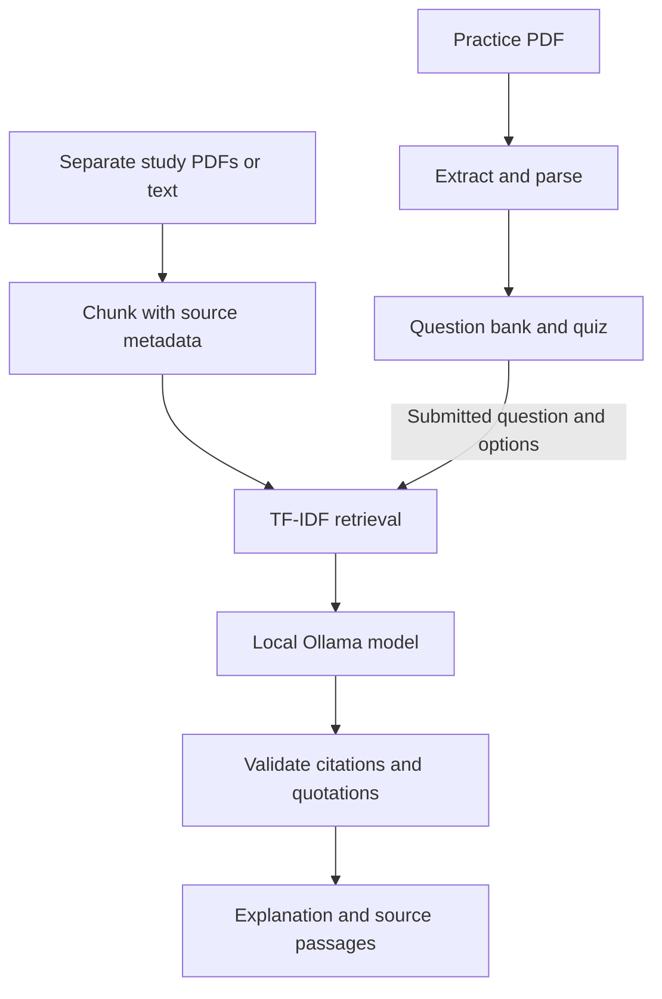

# MCQ Practice Assistant with Local RAG

A personal Python project that converts supported practice-test PDFs into interactive quizzes and explains submitted questions using separately uploaded study materials and a local LLM.

## Features

- PDF text extraction with source-page tracking and layout-aware question parsing.
- Answer keys derived exclusively from green-highlighted options in supported PDFs. Ambiguous questions are excluded and reported.
- Single-answer radio controls, multi-answer checkboxes, review flags, navigation, scores and percentages.
- Separate PDF/TXT study-material ingestion: 300-word passages with 50-word overlap, preserving filenames and page numbers.
- TF-IDF unigram/bigram retrieval, followed by local Llama 3.2 3B generation through Ollama.
- Structured JSON output, source-ID and exact-quotation validation, partial filtering, and one retry when no explanation points validate.
- Post-submission study explanations and a standalone study question interface.

## Architecture



The scoring function is deterministic and independent of the LLM. Source explanations are not used to select correct answers or as the RAG corpus.

## Setup

Use Python 3.10 or newer. In a terminal in this folder:

```powershell
python -m venv .venv
.venv\Scripts\python -m pip install -r requirements.txt
ollama pull llama3.2:3b
```

Install Ollama separately and keep its local service running at `http://127.0.0.1:11434`. The app does not require a paid inference API. Local hardware affects latency.

Start each desired page in a separate terminal:

```powershell
.venv\Scripts\python -m streamlit run app.py --server.port 8501
.venv\Scripts\python -m streamlit run quiz.py --server.port 8502
.venv\Scripts\python -m streamlit run study_materials.py --server.port 8503
.venv\Scripts\python -m streamlit run rag_study.py --server.port 8504
```

1. Upload a supported practice PDF to app.py and download its question bank.
2. Upload that JSON to quiz.py, answer questions and submit.
3. Upload your own PDF/TXT study sources to study_materials.py and download prepared materials.
4. In the submitted quiz, upload the prepared materials under **Explain using my study materials**, choose a question and request an explanation.
5. Alternatively use rag_study.py for independent study questions.

## Demo without a practice PDF

Upload `examples/demo_question_bank.json` in the quiz. Prepare `examples/demo_study.txt` on the study-materials page, then use the downloaded study JSON in the submitted quiz. These are original fictional examples, not exam content.

## Scoring

Each question is worth one mark. Score equals the number of selected correct options divided by the total number of correct options. Unanswered questions score zero; incorrect selections incur no deduction. Consequently selecting every option in a multi-answer question earns full marks. This is a deliberate practice rule, not a secure assessment design.

## Status and limitations

This is a prototype, not a production system. A local user workflow has been exercised with a 40-question bank. No measured accuracy or latency benchmark is claimed.

- PDF parsing depends on layout and green answer highlighting; it is not a universal PDF parser and has no OCR fallback.
- The packaged parser contains later fixes; question counts can differ from the user's earlier 40-question bank.
- Retrieval uses keyword similarity, not embeddings or a vector database. It returns up to three passages above a heuristic score threshold; this is not a confidence probability.
- A matching quotation proves text provenance, not that it supports the generated claim. Human review is still needed.
- Requests are independent; quiz state lasts only within the browser session. No persistent database or authentication.
- No autonomous agent, tool-selection loop or training/fine-tuning is implemented.
- Uploaded third-party study PDFs, extracted banks, and personal results are intentionally excluded from this repository.
- Dependencies use compatibility ranges, not a fully tested lockfile. Live Streamlit/Ollama integration must be verified in the target environment.

## Next steps

Evaluate ten representative questions, improve answer comparisons and retrieval based on failures, persist quiz progress, then explore bounded agentic study planning. See `docs/INTERVIEW.md` for the project explanation and `docs/GITHUB_SETUP.md` for publishing instructions.
